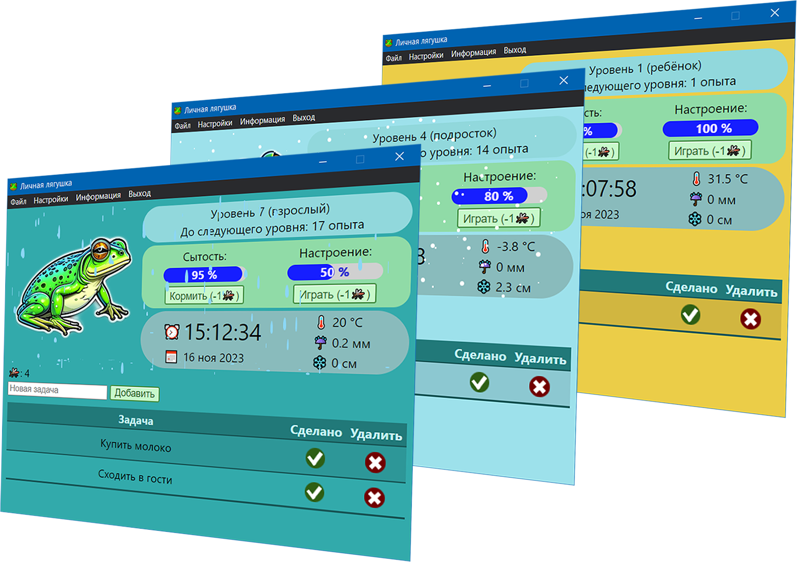

# OwnFrogElectron

OwnFrog is a desktop app built with Electron. It combines elements of a to-do list and a virtual pet sim.

You must manage stats of your pet frog to keep it fed and happy. Those actions consume flies which you can receive by creating and completing tasks.

Additionally, the app displays the current date, time, temperature and precipitation. Certain weather conditions may affect your frog's mood or appetite.

Background colour changes based on the current temperature. Rain and snow are visualised when present. Visual weather can be disabled in the app settings.

